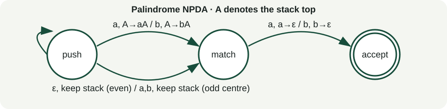
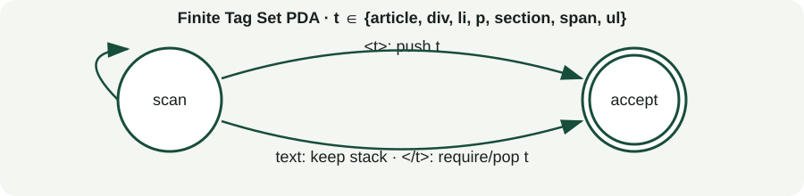
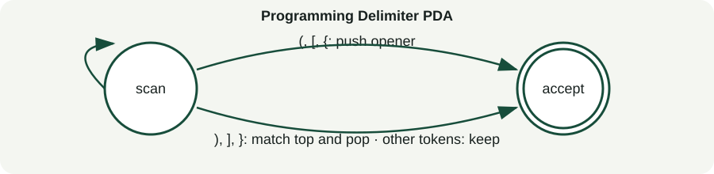

# FLA Task 3 — PDA and CFG Case Study Lab

**Course:** 21CSC301T Formal Language and Automata · CLA-2, Assessment Task 3
**Student:** Rushdham Malik · B.Tech. Artificial Intelligence and Machine Learning

A Flask demonstration and short formal case-study report on three languages that need stack memory: palindromes, nested paired tags, and programming delimiters. Each case states its language, CFG, PDA model, example processing, and scope.

| Case study | Language / grammar | Stack model | Determinism |
|---|---|---|---|
| Palindrome checker | `S → aSa \| bSb \| a \| b \| ε` | Guess the midpoint, then compare in reverse | NPDA; an unmarked midpoint requires a guess |
| Paired-tag checker | `S → text S \| <t> S </t> S \| ε` for each supported tag `t` | Push the opening tag type; pop its matching close | Deterministic for the token stream |
| Programming delimiters | `S → (S)S \| [S]S \| {S}S \| ε` | Push openers; pop matching closers | Deterministic after lexical filtering |

## Run the demonstration

```bash
python -m venv .venv
source .venv/bin/activate       # macOS / Linux
# .venv\Scripts\activate      # Windows
pip install -r requirements.txt
python app.py
```

Open `http://127.0.0.1:5000`. Choose one of the three examples, enter an input, and inspect the acceptance result and stack trace.

## Why a finite automaton is insufficient

For balanced parentheses, assume a DFA has pumping length `p`. The string `(` repeated `p` times followed by `)` repeated `p` times must split as `xyz`, with `|xy| ≤ p` and `|y| > 0`. Thus `y` contains only opening parentheses. Pumping `y` adds an opener without a closer, contradicting balance. A finite automaton cannot remember an unbounded nesting depth. The same issue appears in nested tags and mixed programming delimiters. A PDA uses its stack for that unbounded last-in, first-out memory.

An unmarked palindrome also needs the machine to identify its centre. The NPDA can nondeterministically choose a midpoint, store the first half, and compare the remaining input in reverse order.

## Case study 1 — Palindrome checker

**Language.** For the formal example, `L = { w ∈ {a,b}* : w = wᴿ }`, including `ε`. The web form normalizes input to lowercase ASCII letters and ignores whitespace and punctuation before checking it.

**CFG.** `S → aSa | bSb | a | b | ε`. Each recursive production fixes the outer pair; the base production selects an even or odd centre. The grammar is unambiguous because the outermost symbols and the length determine each production.

**PDA.** The NPDA pushes symbols while reading a guessed first half. An ε-choice changes to the comparison phase; for odd strings, a transition may consume one centre symbol without changing the stack. In the comparison phase, each input symbol must equal and pop the stack top. Accept when input and stored half are both exhausted.



**Accepted:** `ε`, `abba`, `abcba` (the app generalizes the formal alphabet beyond `{a,b}`).
**Rejected:** `ab`, `abc`, `abca`.

Example successful branch for `abba` (stack top at the left):

```text
(push, abba, Z0) ⊢ (push, bba, aZ0) ⊢ (push, ba, baZ0)
                 ⊢ (match, ba, baZ0) ⊢ (match, a, aZ0)
                 ⊢ (match, ε, Z0)  ACCEPT
```

The app tries candidate midpoint branches in ordinary Python. That is a simulation of nondeterministic choice, not a claim that the host program itself is a PDA.

## Case study 2 — Paired-tag validation

**Language.** Consider a finite token alphabet with text token `text` and paired tag tokens for `t ∈ T`, where `T = {article, div, li, p, section, span, ul}`. A string is valid when tags nest and close in last-opened, first-closed order. The app ignores text between tags; it supports this finite tag set and does not implement HTML5.

**CFG.** For each `t ∈ T`, `S → text S | <t> S </t> S | ε`. A tag production represents one properly nested element followed by any remaining valid sequence. This grammar is unambiguous over the stated tokenization: the first token determines whether to end, consume text, or begin a specific tag.

**PDA.** On `<t>`, push `t`; on `</t>`, require `t` at the stack top and pop it. Text leaves the stack unchanged. Accept at end of input with only the bottom marker remaining. A missing, crossed, or unsupported tag rejects.



**Accepted:** `<p></p>`, `<div><p>x</p></div>`, `<ul><li><span>x</span></li></ul>`.
**Rejected:** `<p>`, `</p>`, `<div><p></div></p>`, `<main></main>`.

For `<div><p>x</p></div>`, the relevant stack trace is `[] → [div] → [div,p] → [div] → []`, so the input is accepted. For `<div><p></div></p>`, `</div>` encounters `p` at the top and rejects.

## Case study 3 — Programming delimiter checker

**Language.** After a lexer removes ordinary text, quoted string contents, and `//` line comments, the remaining delimiter tokens must be balanced and correctly nested over `()`, `[]`, and `{}`. The lexical filter also checks that quoted strings close.

**CFG.** `S → (S)S | [S]S | {S}S | ε`. Each non-empty string consists of one balanced outer pair followed by another balanced string. The decomposition is unique, so this grammar is unambiguous.

**PDA.** Push each opening delimiter. On a closer, compare against the top and pop only the matching opener. Reject on an empty stack or a mismatch; accept at end when the stack is empty and no string is left open. After lexical filtering, this is a deterministic pushdown check.



**Accepted:** `()`, `{[()]}`, `if(a){x[0]=(b+c);}`, `call("["); // } ignored`.
**Rejected:** `(`, `([)]`, `x]`, `"unclosed`.

For `{[()]}`, the stack changes `[] → [{] → [{, (] → [{] → []`, then accepts. For `([)]`, reading `)` finds `[` on top rather than `(` and rejects immediately.

## Limitations

- The palindrome input filter ignores punctuation and whitespace and lowercases ASCII letters. It is an educational choice, not a universal text definition.
- The paired-tag checker supports only the finite set above and ordinary tag-like tokens. It does not validate full HTML, comments, void elements, attributes, or browser parsing rules.
- The programming example checks delimiter nesting and closed quotes while skipping `//` comments. It does not parse expressions, declarations, types, or a complete programming language.
- The CFG/PDA descriptions operate on the stated token alphabets. The app includes a small lexer around those models.

## Repository layout

```text
app.py                  Flask routes and web entry point
validators.py           Three case-study recognizers and trace generation
templates/index.html    Interactive case-study interface
static/style.css        Responsive visual style
docs/case-study-report.md  Formal definitions, examples, and limitations
docs/diagrams/          PDA state diagrams in SVG
```

See [the case-study report](docs/case-study-report.md) and [the PDA diagrams](docs/diagrams/).
